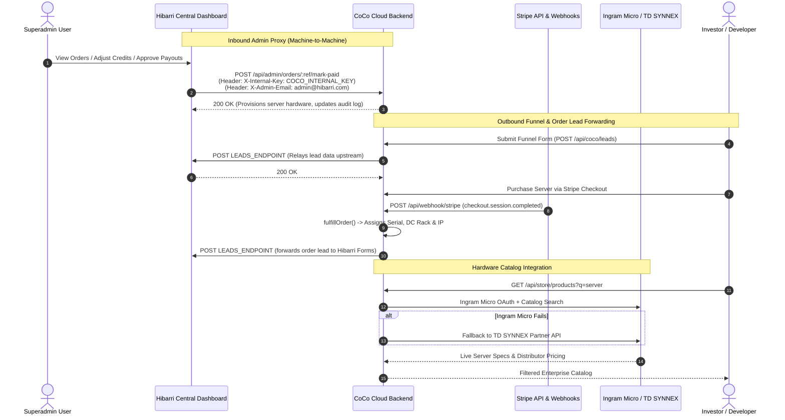

# CoCo Backend Environment Configuration & Hibarri Dashboard Integration

This guide provides a senior architectural review of all environment variables configured in `coco/backend/.env` and `.env.example`, detailing how CoCo connects with the **Hibarri Central Superadmin Dashboard** and third-party upstream providers.

---

## 1. System Architecture & Cross-Service Flows

The diagram below illustrates the bidirectional interactions between CoCo Cloud and Hibarri Central:



---

## 2. Complete Environment Variable Audit (.env & .env.example)

### A. Core Server & Database

| Variable | Type | Default / Example | Required | Purpose & Architectural Context |
| :--- | :--- | :--- | :--- | :--- |
| `PORT` | Number | `5001` | No | Listening port for the CoCo backend HTTP service. |
| `NODE_ENV` | String | `development` / `production` | Yes | Controls CORS strictness, logging output (`morgan` combined vs dev), and cookie security. |
| `MONGODB_URI` | URI | `mongodb+srv://...` | **Yes** | MongoDB connection string. Server enforces strict validation on startup and will terminate if unconfigured. |
| `CLIENT_URL` | String | `http://localhost:5173` | **Yes** | Comma-separated list of allowed web origins for CORS, Stripe redirect return links, and email CTAs. |
| `TRUST_PROXY` | Number | `2` | No | Number of reverse proxies in front of Express (e.g. Vercel rewrite + Railway/Render LB). Ensures rate limiters track real client IPs instead of the load balancer. |

---

### B. Security & Hibarri Internal Authentication

| Variable | Type | Default / Example | Required | Purpose & Architectural Context |
| :--- | :--- | :--- | :--- | :--- |
| `JWT_SECRET` | String (Hex/Base64) | 32+ character random string | **Yes** | Cryptographic key used to sign and verify user authentication JWTs. |
| `JWT_EXPIRES_IN` | String | `7d` | No | Expiration duration for signed session tokens. |
| `COCO_INTERNAL_KEY` | String (64-char Hex) | `0123456789abcdef...` | **Yes** | **Shared Machine Secret between Hibarri Central and CoCo.** Matches `COCO_INTERNAL_KEY` in the Hibarri backend `.env`. Used to authenticate incoming `/api/admin/*` calls via `X-Internal-Key` using constant-time hashing. |

> [!IMPORTANT]
> **Zero Secret Leakage:** `COCO_INTERNAL_KEY` must never be exposed to frontend code or client browsers. The Hibarri Central backend proxy acts as the sole authorized caller of this secret.

---

### C. Hibarri Outbound Lead Forwarding

| Variable | Type | Default / Example | Required | Purpose & Architectural Context |
| :--- | :--- | :--- | :--- | :--- |
| `LEADS_ENDPOINT` | URL | `https://api.hibarri.com/api/coco/leads` | Recommended | Upstream Hibarri endpoint where lead submissions and paid server orders are automatically relayed. Feeds into **Hibarri Superadmin > Coco > Forms**. |

**How It Operates:**
1. **Funnel Relay:** `POST /api/coco/leads` accepts leads formatted as `text/plain` from legacy marketing builds and relays them to `LEADS_ENDPOINT`.
2. **Paid Order Forwarding:** Inside `coco/backend/src/controllers/webhookController.js`, when a `checkout.session.completed` event is verified, `forwardToLeads()` posts:
   ```json
   {
     "form": "server-order-paid",
     "data": {
       "reference": "COCO-A8F29C14",
       "amount": 12500,
       "currency": "usd",
       "email": "investor@example.com",
       "datacenter": "Ashburn, VA",
       "model": "dell-r760-h100"
     },
     "submittedAt": "2026-10-16T12:00:00.000Z"
   }
   ```

---

### D. Stripe Billing, Webhooks & Plans

| Variable | Type | Default / Example | Required | Purpose & Architectural Context |
| :--- | :--- | :--- | :--- | :--- |
| `STRIPE_SECRET_KEY` | String | `sk_test_...` / `sk_live_...` | **Yes** | Secret key for Stripe SDK API communication. |
| `STRIPE_WEBHOOK_SECRET` | String | `whsec_...` | **Yes** | Used to cryptographically verify raw incoming webhook bodies at `POST /api/webhook/stripe`. |
| `STRIPE_PRICE_HOBBY` | String | `price_...` | For dev plans | Stripe Price ID for $5/mo Hobby Developer Subscription tier. |
| `STRIPE_PRICE_PRO` | String | `price_...` | For dev plans | Stripe Price ID for $25/mo Pro Developer Subscription tier. |
| `BILLING_JOBS` | String | (empty) or `off` | No | Set `BILLING_JOBS=off` on secondary replicas to prevent concurrent background timers. Note that database `JobLock` prevents race conditions regardless. |

> [!NOTE]
> **Shared Stripe Account Handling:** CoCo shares its Stripe account with other Hibarri ecosystem projects. The webhook dispatcher inspects `event.data.object.metadata.app === 'coco'` or developer billing plans, safely ignoring non-CoCo Stripe events.

---

### E. Developer Compute Metering & Runtime

| Variable | Type | Default / Example | Required | Purpose & Architectural Context |
| :--- | :--- | :--- | :--- | :--- |
| `DEV_RUNTIME` | String | (empty) or `external` | No | When empty, CoCo runs a lightweight simulated usage generator for development and demos. In production, set to `external` so physical orchestrators push real measurements. |
| `METER_INGEST_KEY` | String | 32+ char secret | When external | Secret passed in the `X-Meter-Key` header by container orchestrator nodes posting compute usage to `POST /api/dev/usage/ingest`. |

---

### F. Distributor Hardware Integrations

CoCo connects to enterprise hardware distributors to populate the hardware store with live inventory:

| Variable | Type | Purpose |
| :--- | :--- | :--- |
| `INGRAM_CLIENT_ID` | String | OAuth 2.0 Client ID for Ingram Micro Xvantage Developer API |
| `INGRAM_CLIENT_SECRET` | String | OAuth 2.0 Client Secret for Ingram Micro Xvantage |
| `INGRAM_CUSTOMER_NUMBER` | String | Distributor account customer number |
| `INGRAM_COUNTRY_CODE` | String | Country code for catalog queries (e.g. `US`) |
| `INGRAM_API_BASE` | URL | Default `https://api.ingrammicro.com:443` (Sandbox or Prod) |
| `INGRAM_TOKEN_URL` | URL | OAuth token endpoint (`/oauth/oauth30/token`) |
| `INGRAM_SEARCH_KEYWORD` | String | Default search query (`server`) |
| `INGRAM_VENDORS` | String | Comma-separated vendor filter (e.g. `Dell,HPE,Lenovo`) |
| `TDSYNNEX_API_BASE` | URL | Backup distributor API base URL |
| `TDSYNNEX_CLIENT_ID` | String | TD SYNNEX API client credentials |
| `TDSYNNEX_CLIENT_SECRET` | String | TD SYNNEX API client secret |
| `TDSYNNEX_SEARCH_KEYWORD` | String | Backup search term (`server`) |

---

### G. Transactional Email & Broadcasts

| Variable | Type | Default / Example | Required | Purpose & Architectural Context |
| :--- | :--- | :--- | :--- | :--- |
| `SMTP_HOST` | String | `smtp.example.com` | For emails | SMTP mail server hostname. |
| `SMTP_PORT` | Number | `465` (SSL) or `587` (TLS) | For emails | SMTP connection port. |
| `SMTP_USER` | String | `coco@coco.hibarri.com` | For emails | Mail server account username. |
| `SMTP_PASS` | String | `********` | For emails | Mail server password / app-password. |
| `EMAIL_FROM` | String | `"CoCo by Hibarri <coco@coco.hibarri.com>"` | No | Display name and sender address. |
| `EMAIL_REPLY_TO` | String | `support@hibarri.com` | No | Reply-to destination for customer queries. |
| `BROADCAST_TITLE` | String | `Real Estate vs Digital Estate` | No | Topic title included in confirmation emails and ICS calendar files. |
| `BROADCAST_DURATION_MIN`| Number | `75` | No | Broadcast runtime in minutes for calendar invites. |
| `WHITEPAPER_URL` | String | `/Whitepaper on Compute - Coco by Hibarri.pdf` | No | Relative or absolute download URL for the compute white paper. |

---

## 3. Recommended Production Environment Checklist

1. [ ] Generate `COCO_INTERNAL_KEY` using `node -e "console.log(require('crypto').randomBytes(32).toString('hex'))"` and mirror the exact value in Hibarri Backend `.env`.
2. [ ] Verify `LEADS_ENDPOINT` points to the production Hibarri endpoint: `https://api.hibarri.com/api/coco/leads`.
3. [ ] Configure live Stripe keys (`sk_live_...` and `whsec_...`) and register the webhook URL: `https://api.coco.hibarri.com/api/webhook/stripe`.
4. [ ] Ensure `DEV_RUNTIME=external` and `METER_INGEST_KEY` are provisioned across compute hypervisors.
5. [ ] Verify Swagger UI is accessible at `https://api.coco.hibarri.com/api-docs` for authorized developers.
